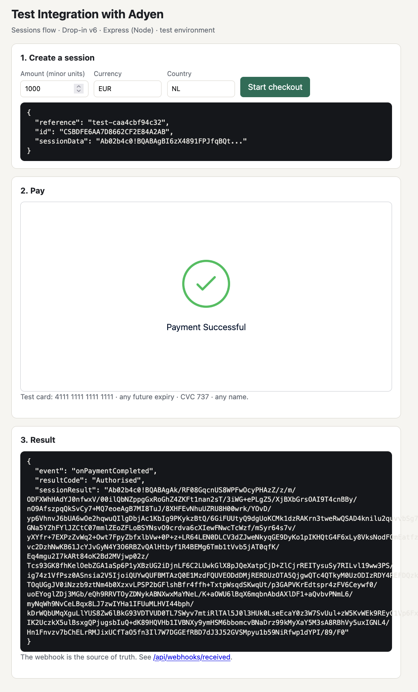

# Test Integration with Adyen (Node)

The Node/Express twin of [test-integration-with-adyen](https://github.com/mettakite/test-integration-with-adyen)
(Python/Flask). Same shape, same endpoints, same HMAC rules, same front end, so the two can be read side by side:
clone either one and you have an Adyen Checkout integration running in ten minutes.

```
browser ──POST /api/sessions──▶ Express ──POST /v71/sessions──▶ Adyen
browser ◀── { id, sessionData } ── Express
Drop-in renders ▶ shopper pays ▶ Adyen ──webhook──▶ Express /api/webhooks/notifications (HMAC checked, idempotent)
```

No SDK, no bundler: plain `fetch` to Adyen, stdlib `crypto` for HMAC, Drop-in v6 from Adyen's CDN. Everything a
first-time integrator has to get right is visible in about 200 lines.



## What's in it

| Path | What it does |
| --- | --- |
| `server.js` | Express app: `/` checkout page, `POST /api/sessions`, `POST /api/webhooks/notifications`, `GET /api/webhooks/received`, `/redirect`, `/healthz` |
| `adyen.js` | Builds and sends the `/sessions` request |
| `webhook.js` | Standard-webhook HMAC-SHA256 verification (matches Adyen's published test vector; escapes `\` and `:` like Adyen's libraries do) |
| `public/checkout.js` | Loads Drop-in v6 from the CDN, creates the session, mounts Drop-in, reports every lifecycle event |
| `public/redirect.js` | Finishes redirect payment methods (iDEAL, 3DS) via `submitDetails` |
| `test/` | 19 tests on Node's built-in runner: HMAC vector and tamper cases, session request shape, webhook endpoint behavior including duplicate deliveries |

## Run it

1. **Credentials** from [Customer Area (test)](https://ca-test.adyen.com): API key and client key (Developers > API credentials,
   then **Save changes**, the key is not active until you do), your merchant account code, and an HMAC key
   (Developers > Webhooks > Standard webhook). Add `http://localhost:8081` to the credential's **Allowed origins**.
2. **Configure and start** (Node 18+):
   ```bash
   cp .env.example .env     # fill in the four ADYEN_* values
   npm install
   npm start                # http://localhost:8081
   ```
3. **Pay** with test card `4111 1111 1111 1111`, any future expiry, CVC `737`. Expect `resultCode: Authorised`.
4. **Webhook** (optional). Expose port 8081 and point the Standard webhook at `https://<tunnel>/api/webhooks/notifications`:
   ```bash
   cloudflared tunnel --url http://localhost:8081   # no account needed; or ngrok http 8081
   ```
   Accepted notifications show at `http://localhost:8081/api/webhooks/received`.

## Test

```bash
npm test
```

## Notes

- Amounts are in minor units: `1000` with `EUR` is EUR 10.00.
- Duplicate webhook deliveries (same `pspReference` + `eventCode`) are acknowledged with 200 but recorded once. Adyen
  retries until it gets a 200, so an endpoint that is slow once will see the same event twice.
- Items that fail HMAC are logged and dropped but still get a 200, so Adyen does not retry a tampered item forever.
  A missing HMAC key returns 500 so misconfiguration is loud.
- Drop-in is pinned to 6.46.0 from Adyen's CDN. For production, add the `integrity` attributes from the release notes.
- The Python version's [FRICTION_LOG.md](https://github.com/mettakite/test-integration-with-adyen/blob/main/FRICTION_LOG.md)
  covers the docs and Customer Area findings for both; the Node-specific notes are in [STATUS.md](STATUS.md).
